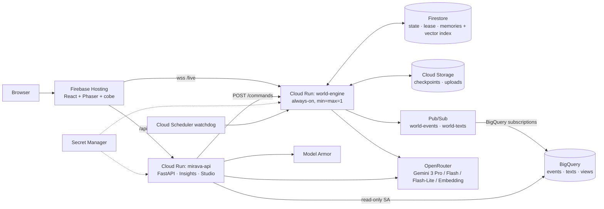

# mirava.ai — an always-on world of 1,000 AI agents for testing product launches

**mirava.ai** (working name *Launch Lens*) is a living pixel-art Indiranagar, Bengaluru, where 1,000 AI agents work, commute, scroll, talk and shop around the clock. Launch a phone into it, then watch who notices your hoardings, what they privately think, what they tell friends and who buys. Then ask Gemini *why*.

Built for the **Google Cloud AI Builder Cup 2026 — Retail & Commerce**.

> All people, numbers, stores and ads are **simulated**. Stores and media are fictional. Real phone brands appear only as possessions agents already own (labelled simulated).

**Live:** https://mirava-ai-hack.web.app

## What it does
- **Always-on world.** Runs on Cloud Run 24/7; 1 sim day = 1 real hour. The city is generated from OpenStreetMap (299×305 tiles, 3,501 road nodes, 12,179 places, 60 hoarding sites, 4 fictional stores).
- **Agents with inner lives.** Each agent has a persona, private layered memory, needs and a routine, money and credit, relationships, a media diet and a phone of a certain age and condition (1,000 agents, 435 households, 7,012 relationships).
- **Attention before thought.** Exposure geometry and an attention model decide pass / glance / notice with no model call. Only *noticed* ads produce a logged private thought.
- **Think vs speak.** Conversations: private prep → dialogue from share plans (≤ 10 messages each) → private debrief. Store inquiries run turn by turn (think → decide → speak) with a salesperson who sees only the spoken transcript.
- **Launch Studio.** Add products and creatives (posters, reels, posts, newspaper ads, store displays). The studio scores claim risk and creative salience, builds an Obsidian-style knowledge graph and **plans hoardings automatically**, with reasons.
- **Launch moment.** Products launch one at a time from the World's *Ready to launch* dock with a firework; sites flip, reels go out, reviewers publish, community threads grow.
- **Insights.** Every event is logged to BigQuery. A Gemini assistant answers questions over the data with SQL, charts and verbatim quotes. Dashboards include **Hoardings** (out-of-home by site and facing), Segments, Funnel and a Survey Room.

## Try it
Open the live world at https://mirava-ai-hack.web.app (desktop browser, 1280 px or wider).

## Architecture

Only `world-engine` writes world state (it holds a Firestore lease). Everything else reads or sends commands.

## Google Cloud services
| Service | Why |
|---|---|
| Cloud Run `world-engine` | The always-on, single-writer simulation (min = max = 1, no CPU throttling, session affinity for WebSockets) |
| Cloud Run `mirava-api` | REST, uploads, commands to the engine, Insights assistant (scales to zero) |
| Firebase Hosting | Web app and the `/api` rewrite |
| Firestore | Live world state, engine lease, per-agent memories with a 768-d vector index |
| Cloud Storage | Genesis and checkpoints (versioned), creative uploads, exports |
| Pub/Sub → BigQuery subscriptions | Every event and text row streamed into BigQuery with no glue code |
| BigQuery | Exact event log, curated views (`v_exposures`, `v_site_daily`, `v_first_heard`, `v_funnel_daily`, …), `VECTOR_SEARCH` over texts |
| Secret Manager | OpenRouter key (primary + fallback) mounted into both services |
| Model Armor | Screens uploads and Insights questions (prompt injection, jailbreak, RAI) |
| Cloud Scheduler | Watchdog calling the engine's `/health` every 5 minutes |
| Cloud Build + Artifact Registry | Container builds and deploys |

Models: Gemini 3 only, via OpenRouter (`google/gemini-3.1-pro-preview`, `google/gemini-3.6-flash`, `google/gemini-3.5-flash-lite`, `google/gemini-embedding-001`). Model ids live only in `shared/models.py`.

## Privacy model
- `MemoryStore(agent_id)` reads and writes only that agent's memories and beliefs.
- Every agent prompt is built for **one** agent by `mind.context.build`.
- Shared prompts (dialogue) accept only typed **SharePlans** and public text, so agents share only what they choose to say. The salesperson sees only the spoken transcript.
- Private events carry `private: true` and never enter another agent's prompt. Marker-fact tests prove there is no leakage.

## Budget governor
- Every background model call asks `governor.allow(priority_class, est_cost)`.
- **$15/day** background cap and **$5/day** interactive cap, plus per-sim-day and per-sim-hour caps by priority class (store inquiries > ad thoughts > product chats > reflection > social chats > posts).
- Over-cap work becomes `rendered=false` with rule/template fallbacks. The clock can slow (1×–3× real hours per sim day), but the world never stops.
- Low reasoning effort, tight `max_tokens`, usage accounting on every call; results cached by input hash for determinism.

## Run locally
```bash
# Windows: Git Bash. One-time: source .devpath.sh
uv sync && (cd web && npm install) && (cd tools/visual && npm ci && npx playwright install chromium)
make genesis      # once, emulator running (fake LLM)
make dev          # Firestore emulator (Java 21+) + world-engine :8100 + api :8000 + web :5173 (fakes, 120 s/day)
make seed-demo    # Pixel 10 Pro ready; Pixel 10a, Galaxy S26 Ultra, Galaxy A57, iPhone 17 live
make test && make lint
```
Open http://localhost:5173 (visual-test mode: http://localhost:5173/world?visualTest=1). For real models, put `OPENROUTER_API_KEY` in `.env` (git-ignored) and set `LLM_BACKEND=openrouter`.

## Deploy
```bash
make deploy                                                                          # mirava-api + Firebase Hosting
gcloud builds submit --config infra/cloudbuild-engine.yaml --region asia-south1 .    # world-engine
uv run python -m infra.bigquery.init mirava-ai-hack mirava                           # BigQuery tables + views
uv run python -m tools.seed_demo --api https://mirava-api-kfh7v3hvjq-el.a.run.app    # demo products
```

## Eval results (latest: 200 agents · 2 sim days · fake backend)
- Insights benchmark: **faithfulness 100%**, quotes verbatim 100%, 9/10 questions pass. The `first_heard` routing miss was fixed afterwards and is pinned by a unit test.
- Survey realism: all 6 checks pass. Extraversion ↔ messages r = 0.53; conformity higher in high-agreeableness agents; experience dominance 0.83; 11.7% of opinions shifted (every change cited); wave changes explained 100%; satisficing shows up late and in low-conscientiousness agents.
- Full tables: `evals/RESULTS.md`.

## Live URLs
- Web: https://mirava-ai-hack.web.app
- API health: https://mirava-ai-hack.web.app/api/healthz
- world-engine health: https://world-engine-kfh7v3hvjq-el.a.run.app/health

## Attribution and licence
Map data © OpenStreetMap contributors, ODbL. Fonts: Inter and JetBrains Mono (SIL OFL).

Licence: MIT (see `LICENSE`).
