# Launch Lens — Architecture v3 (Always-on Agent World)

*Version 3.0 · 17 Oct 2026 · Google Cloud AI Builder Cup 2026 · Companion to `docs/specs.md` v3 (spec IDs W-, P-, E-, M-, A-, C-, T-, S-, L-, I-, U-, X-)*
*Working name. The platform is an always-on **agent world**; **Launch Lens** (testing product launches and marketing inside that world) is its first use case.*

---

## 0. How to read this document

The architecture is designed **feature by feature**. Each feature section designs one feature group in isolation: what it does, the decisions behind it, its components and data, and its own Mermaid flow. It then states how the feature plugs into the main system. Section 16 assembles everything into the **end-to-end architecture**.

| § | Feature | Group | Specs | Build phase |
|---|---|---|---|---|
| 1 | What we are building, drivers, constraints, what changed | — | — | — |
| 2 | Feature → spec → phase map | — | all | — |
| 3 | Principles, Google Cloud usage, model access, units | — | — | — |
| 4 | F1 Platform foundation | X, U | X-01, X-02, U-01, U-09 | 1 |
| 5 | F2 World: globe, Indiranagar map, places, hoarding sites | W | W-01 … W-04, W-10 | 1 |
| 6 | F3 Population: agents, personas, relationships, possessions, media diet | P | P-01 … P-08 | 2 |
| 7 | F4 Always-on engine: clock, day loop, movement, checkpoints, live stream, highlights | W, E | W-05 … W-09, E-01 … E-07 | 2–3 |
| 8 | F5 Memory: layered memory, retrieval, reflection, isolation | M | M-01 … M-07 | 3 |
| 9 | F6 Perception & attention: hoardings, feeds, print | A | A-01 … A-06 | 4 |
| 10 | F7 Channels: hoardings, reels, newspaper, reviewers, community, stores, word of mouth | C | C-01 … C-08 | 4 |
| 11 | F8 Conversations: encounter gate, think/speak, store inquiries | T | T-01 … T-07 | 3, 5 |
| 12 | F9 Needs, consideration and buying | S | S-01 … S-06 | 5 |
| 13 | F10 Launch Studio: products, content, understanding, auto placement, launch moment | L | L-01 … L-08, P-07 | 4 |
| 14 | F11 Insights: Ask assistant, dashboards, hoardings, segments, polls, interviews | I | I-01 … I-09 | 5 |
| 15 | F12 World UI: globe, world view, profiles, people, highlights | U | U-02 … U-08 | 1–5 |
| 16 | **End-to-end architecture**: main diagram, lifecycles, data, API, deployment | — | all | — |
| 17 | Budget governor and cost model | E | E-05 | 3 |
| 18 | Security, privacy, isolation, reliability, observability | X | X-03, X-04, M-07 | 6 |
| 19 | Performance targets | — | — | — |
| 20 | Scale path (1k → 100k agents) | — | V1 | — |
| 21 | Demo plan, fallbacks, repo layout, build order | X | X-05, X-06 | 6 |
| 22 | Risks and open questions | — | — | — |

Every feature section has the same shape: **Scope → Design decisions → Components → Data → Flow → Connection to the main system.**

---

## 1. What we are building

A **living, always-on world of 1,000 AI agents** in a pixel-art version of **Indiranagar, Bengaluru**, generated from OpenStreetMap. The world runs by itself on Google Cloud, all the time, whether or not anyone has the app open. **1 sim day = 1 real hour**, so the world lives about 24 days for every real day.

Agents are sampled from population statistics. Each agent has:
- a persona: personality, values, lifestyle, interests and speaking style
- a household and relationships
- a daily routine and a media diet
- money and credit
- possessions, starting with a phone (brand, model, age, condition)
- a **private, layered memory**

Agents walk, ride, take the metro, work, eat, shop, scroll their phones, read the paper, browse a Reddit-style community, meet people they know and talk.

When you open the app, a **globe** spins in and flies into the city. The **World** page shows the live city and world stats. The only product action on it is **New product**, plus a small **Ready to launch** dock. Product teams use **Launch Studio** to add several products one after another. Each product has details, features, target personas and marketing content: hoarding posters, reels (transcripts and scene descriptions), posts, newspaper ads and store displays. Launch Studio understands the content (claims risk, creative salience, an interactive knowledge graph) and **automatically plans** where the hoardings go and which way they face, which agents' feeds receive the reels, which reviewers get a unit, and which stores stock the product. Back in the World, each product is **launched one at a time** with a firework-style drop that bursts into the city.

From then on the world shows how people meet the product:
- **Hoardings.** Most people pass them by, some glance, a few notice. Those who notice have a **private thought** that is logged.
- **Feeds.** Reels reach interested agents' feeds.
- **Newspaper.** Agents who read the paper see the print ads.
- **Reviewers.** Reviewer agents form a private opinion and publish a review.
- **Community.** Agents read the Reddit-style community, post and comment.
- **Friends.** Agents talk to friends (up to 10 messages each), sharing only what they choose to say.
- **Stores.** Agents walk into stores and question a salesperson.
- **Purchases.** A purchase happens only when need, budget and intent line up.

Everything is logged exactly in **BigQuery**. Each agent also keeps a human-like episodic memory in **Firestore**. The **Insights** page has a Gemini assistant that answers any question over everything the world has accumulated, for example: "People whose phones are older than 5 years: which of our phones interests them, and why?" A **Hoardings** tab shows which sites and facing directions actually win attention, which is the basis for a pitch to out-of-home (OOH) media owners.

### 1.1 Architectural drivers
| Driver | Consequence |
|---|---|
| The world must run continuously and persist | One always-on engine service with a single-writer lease, checkpoints and a watchdog (§7) |
| Agents must think like individuals, not a crowd | Per-agent layered memory, persona card, beliefs; single-agent memory access (§8) |
| Private thoughts must never leak | Private vs public channels; 3-step conversations; turn-by-turn store inquiries (§11) |
| Realistic attention to ads | Geometry + attention model; only noticed ads cost a model call (§9) |
| Any question must be answerable later | Exact raw log + embeddings in BigQuery; curated views; an assistant with tools (§14) |
| Multiple products and new categories over time | Products are data; beliefs keyed by subject; on-demand category bootstrap (§6, §13) |
| Fixed daily budget ($15) | Budget governor with priority classes, caching, low reasoning effort; time slows before quality collapses (§17) |
| Demo by 18 Oct 2026 | 6 sequential build phases; local-first with fakes; deterministic fixtures (§21) |

### 1.2 Constraints
- Gemini 3 models only, accessed through **OpenRouter** (team key) by default; Vertex AI is a switch. Never `gemini-2.5-*`.
- Google Cloud for everything else. App and data are in `asia-south1`.
- One builder using Claude Code, 6 phases, one fresh session per phase.
- The UI must match `docs/ui-mockup.html` at pixel level (desktop, 1440×900).
- No real retailer names; real phone brands only as owned possessions in the market (labelled simulated).

### 1.3 What changed from v2
| v2 | v3 |
|---|---|
| Per-test branches of a base world, 52-week runs computed then replayed | **One live world that never stops**; products are launched into it; highlights instead of full replays |
| Campaign page with manual slot placement | **Fully automatic** placement with reasons |
| Personal targeting and per-person purchase questions | **Watchlist only**; "likely to buy" is a segment analysis |
| Report page computed after a run | **Insights**: assistant and dashboards over continuously growing data |
| Fictional district map | **Real Indiranagar streets from OSM**, with a globe intro |
| One dialogue call per conversation | **Think/speak separation**: private prep → public dialogue → private debrief; turn-by-turn in stores |
| Phone campaign only | Multiple products, comparable side by side; new categories bootstrapped on demand |

---

## 2. Feature → spec → phase map

| Group | Specs | Build phase | Main Google Cloud services |
|---|---|---|---|
| X Platform | X-01 LLM gateway · X-02 deploy · X-03 security · X-04 observability · X-05 demo seed & fallback · X-06 evals | 1, 6 | Cloud Run, Firebase Hosting, Secret Manager, Cloud Build, Artifact Registry, Logging/Monitoring |
| W World & time | W-01 globe · W-02 OSM map · W-03 places · W-04 hoarding sites · W-05 clock · W-06 always-on engine · W-07 live stream · W-08 highlights · W-09 stats · W-10 day/night | 1–3 | Cloud Run (always-on), Cloud Storage, Firestore, Cloud Scheduler |
| P Population | P-01 sampling · P-02 personas · P-03 relationships · P-04 routines & media diet · P-05 money · P-06 phones & life events · P-07 category bootstrap (stretch) · P-08 special agents | 2, 4 | Firestore, BigQuery, Gemini via OpenRouter |
| E Engine | E-01 day loop · E-02 movement · E-03 encounters · E-04 event log · E-05 budget governor · E-06 determinism · E-07 checkpoint/resume | 2–3 | Pub/Sub, BigQuery, Cloud Storage |
| M Memory | M-01 raw log · M-02 working · M-03 episodic · M-04 beliefs · M-05 reflection · M-06 persona card · M-07 isolation | 3 | Firestore (vector), BigQuery |
| A Attention | A-01 geometry · A-02 attention model · A-03 thoughts · A-04 feed/print · A-05 repetition · A-06 hoarding metrics | 4 | — (engine) + BigQuery views |
| C Channels | C-01 hoardings · C-02 reels · C-03 newspaper · C-04 reviewers · C-05 community · C-06 store displays · C-07 word of mouth · C-08 baseline ads | 4 | Cloud Storage (creatives) |
| T Talk | T-01 gate · T-02 3-step chat · T-03 store inquiry · T-04 transcripts · T-05 strangers · T-06 sessions · T-07 unrendered interactions | 3, 5 | Gemini via OpenRouter, ADK |
| S Shopping | S-01 need · S-02 consideration · S-03 research/visit · S-04 stores & salespeople · S-05 purchases · S-06 baseline market | 5 | — (engine) |
| L Launch Studio | L-01 products · L-02 content · L-03 understanding · L-04 knowledge graph · L-05 personas · L-06 auto placement · L-07 ready dock · L-08 launch moment | 4 | Cloud Storage, Model Armor, Gemini |
| I Insights | I-01 Ask · I-02 overview · I-03 sources · I-04 hoardings · I-05 segments · I-06 conversations · I-07 poll · I-08 interview · I-09 faithfulness | 5 | BigQuery (+ VECTOR_SEARCH), ADK, Gemini 3.1 Pro |
| U UI | U-01 shell · U-02 world · U-03 hover · U-04 profile · U-05 people · U-06 studio · U-07 insights · U-08 guide · U-09 visual-test mode | 1–6 | Firebase Hosting |

---

## 3. Architecture principles and core technology choices

### 3.1 Principles
1. **The world is a single long-running process with one writer.** All agent state changes happen inside `world-engine`. Everything else reads, or sends commands.
2. **Events are the truth.** Every perception, thought, message, inquiry, purchase and belief change is an immutable event. Dashboards and the assistant compute from events.
3. **Private by construction.** An agent's private thoughts and memories are only ever loaded into prompts *for that agent*. Shared prompts see only public speech or share plans.
4. **Spend model tokens only where they change outcomes.** Rules and a cheap decision model filter first; Gemini handles thoughts, dialogue, reflection and analysis.
5. **Products are data.** Launching a new product or category needs no code change.
6. **Local-first.** Everything runs locally with fakes (FakeGemini, DuckDB, Firestore emulator, local disk) and deterministic seeds.
7. **Desktop pixel fidelity.** The mockup is the visual contract (§15, CLAUDE.md §6).

### 3.2 Google Cloud usage
| Service | Role |
|---|---|
| **Cloud Run (service, always-on)** `world-engine` | Runs the world loop 24/7: min = max = 1 instance, CPU always allocated; serves the live WebSocket |
| **Cloud Run (service)** `api` | REST for the web app: products, uploads, launch commands, agents, Insights |
| **Firebase Hosting** | Web app (React + Phaser) with `/api/**` rewrite to `api` |
| **Firestore (Native)** | World state, agent docs, episodic memories (vector index), beliefs, products, sites, stores, community threads, watchlist, Insights sessions, engine lease |
| **BigQuery** | `events` (raw log), `texts` (thoughts/messages/posts with embeddings, VECTOR_SEARCH), curated views for Insights, likely-buyer scoring |
| **Pub/Sub** | Topics `world-events` → BigQuery subscription → `events`; `world-texts` → `texts` |
| **Cloud Storage** | Creatives and uploads, map assets, engine checkpoints, day highlights, exports |
| **Cloud Scheduler** | Watchdog ping of `world-engine` every 5 min; nightly export job (optional) |
| **Secret Manager** | `openrouter-api-key` |
| **Model Armor** | Screens uploaded marketing content and Insights questions for prompt injection |
| **Agent Development Kit (ADK)** | Insights assistant, interviewer, salesperson agent |
| **Cloud Build + Artifact Registry** | Images and deploys |
| **Logging, Monitoring, Trace, Error Reporting, Budgets** | Operations and spend control |

### 3.3 Model access: OpenRouter (default) and Vertex AI
All model calls go through `shared.llm` (text/structured) and `mind.decision` (typed decisions). `LLM_BACKEND=openrouter` uses the OpenAI-compatible API at `https://openrouter.ai/api/v1`, with the team's key from Secret Manager.

| Constant | OpenRouter id | Standard price (per M tokens in / out) | Used for |
|---|---|---|---|
| `MODEL_PRO` | `google/gemini-3.1-pro-preview` | $2.00 / $12.00 | Insights assistant, claim risk, likely-buyer explanations |
| `MODEL_FLASH` | `google/gemini-3.6-flash` | $0.75 / $3.75 | Product-related dialogues, creative understanding (images), persona bios, interviews |
| `MODEL_LITE` | `google/gemini-3.5-flash-lite` | $0.30 / $2.50 | Ad thoughts, private prep/debrief, social dialogues, store turns, reflection, typed decisions |
| `MODEL_EMBED` | `google/gemini-embedding-001` | — | Episodic memory and text embeddings (768-d) |

*Prices were checked on OpenRouter on 17 Oct 2026 and change over time. Flex endpoints cost about half.*

Rules:
- Structured output everywhere: `response_format = {type: json_schema, json_schema: {name, strict: true, schema}}` with `provider.require_parameters = true`.
- Engine calls use **low reasoning effort** and tight `max_tokens`.
- **Usage accounting** is on, so the exact cost of every call feeds the budget governor.
- Results are cached by input hash.
- ADK agents use `LiteLlm(model="openrouter/<id>")`.
- `LLM_BACKEND=vertex` switches to Vertex AI, and `fake` is used in tests.

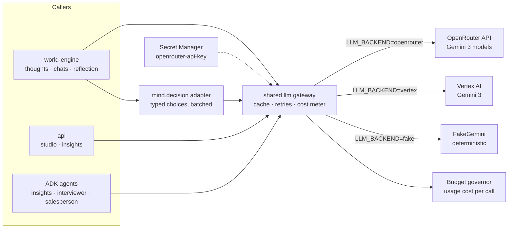

### 3.4 Units and identifiers
- **Sim time**: integer **sim minutes since world epoch** (`t`). Epoch = Mon 00:00 of world day 1. `day = t // 1440`.
- **Real/sim scale**: `SIM_MINUTES_PER_REAL_SECOND = 0.4` (1 sim day = 3,600 real s). Configurable.
- **Space**: world metres from the map's north-west corner (`x` east, `y` south). Tile = 8 m.
- **Money**: integer rupees.
- **IDs**: `agent_id` int 0–999; `product_id` slug; `site_id` like `S-100FT-07`; `session_id` UUID; `event_id` deterministic `{kind}:{t}:{agent}:{seq}`.

---

## 4. F1 — Platform foundation

### 4.1 Scope
App shell and routing, design tokens, visual-test mode, LLM gateway (OpenRouter), shared schemas, local dev stack, first deploy. Specs X-01, X-02, U-01, U-09.

### 4.2 Design decisions
- **Monorepo**: `web/` (React + Vite + TS + Phaser), `engine/` (world loop), `api/`, and shared Python packages (`shared`, `world`, `population`, `mind`, `social`, `media`, `commerce`, `insights`, `agents`).
- **Two Python services from one codebase**: `api` (stateless, scales 0–5) and `world-engine` (stateful, exactly one).
- **Shared pydantic schemas** generate TypeScript types (`make types`) so the web and Python agree on shapes.
- **Visual-test mode** (`?visualTest=1`): fixtures, frozen clock, deterministic seeds, `window.__ll` hooks, `data-testid`s that match the mockup.

### 4.3 Components
| Component | Responsibility |
|---|---|
| `web/` shell | Sidebar (World, Launch Studio, Insights, People, Guide), header (world clock, LIVE pill, SIMULATED DATA pill, budget meter, theme) |
| `shared.settings` | Env config: backends, regions, budget, time scale |
| `shared.llm` | `OpenRouterClient`, `VertexClient`, `FakeGemini`; structured output; cache; retries; usage cost |
| `shared.schemas` | All pydantic models (INTERFACES §2) |
| `shared.store` / `shared.bq` / `shared.files` | Firestore (emulator locally), BigQuery (DuckDB locally), GCS (local disk) |
| `tools/visual` | Pixel-level comparison against `docs/ui-reference` |

### 4.4 Flow
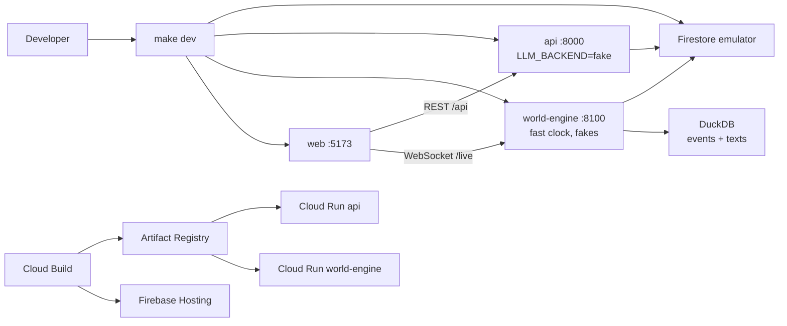

### 4.5 Connection to the main system
Every other feature uses the gateway, schemas, stores and shell defined here. Visual-test mode is how every UI phase proves pixel parity.

---

## 5. F2 — World: globe, Indiranagar map, places and hoarding sites

### 5.1 Scope
The globe intro, the city generated from OpenStreetMap, places and lots, and the hoarding/bus-shelter site inventory. Specs W-01, W-02, W-03, W-04, W-10.

### 5.2 Design decisions
- **Globe intro** with `cobe` (MIT, WebGL dotted globe): it rotates to Bengaluru (12.9719 N, 77.6412 E) with a pulsing marker and world stats, and **Enter world** zooms into the city. The view cross-fades from globe to map. If WebGL is unavailable, the app goes straight to the World.
- **Real streets, pixel style.** `tools/mapgen` downloads OSM data for bbox **12.962–12.984 N, 77.630–77.652 E** (≈ 2.4 × 2.4 km) through the Overpass API (cached and committed as `assets/osm/indiranagar.osm.json`; manual export fallback in `docs/setup/15-openstreetmap.md`). It projects to local metres, rasterises to **8 m tiles (~300 × 300)** and writes:
  - `assets/maps/indiranagar.tmj`: Tiled map with layers ground, landuse, roads, rail/metro, buildings, decor and labels
  - `roadgraph.json`: nodes and edges with length, class and allowed modes
  - `places.json` and `sites.json`
- **Rendering**: Phaser 3 draws tile layers. Buildings get roof colours by type (residential, commercial, office, retail, school, hospital). The metro viaduct runs along CMH Road. Labels show main roads (100 Feet Road, CMH Road, 12th Main, Double Road, Old Airport Road). Day/night lighting comes from the clock (W-10).
- **Attribution**: "© OpenStreetMap contributors (ODbL)" is shown on the map and in the Guide.
- **Places** come from OSM tags plus `config/places_overrides.yaml`:
  - homes (residential buildings, split into households)
  - offices and tech parks
  - shops, cafés and restaurants
  - **stores** (fictional names: Digital Bazaar, ElectroHub, PhoneWorld, brand lots)
  - schools, colleges, gyms and parks
  - Indiranagar metro station and bus stops
  - a newspaper vendor
- **Hoarding sites** are generated deterministically:
  - major junctions on primary/secondary roads (degree ≥ 3)
  - along arterials every ~150 m on both sides
  - metro station pillars and exits
  - bus shelters
  - mall/building façades

  Each site gets one or two **facing** options aligned to oncoming traffic, a size class (billboard 40×20 ft, unipole, bus shelter, metro panel, façade screen), `lit` (illuminated at night), `height_m`, and a **visibility cone** (half-angle and max distance by size class). The target is about 60 sites.

### 5.3 Components
| Component | Responsibility |
|---|---|
| `tools/mapgen/fetch_osm.py` | Overpass query → raw JSON (cached) |
| `tools/mapgen/build.py` | Projection, rasterisation, Tiled layers, road graph, places, sites |
| `world/map.py` | Loads map, road graph, places, sites; spatial index (grid buckets) |
| `world/sites.py` | Site geometry: `in_view(agent_pos, heading) → (visible, distance, angle, dwell)` |
| `web/src/globe/` | `cobe` globe component and fly-in transition |
| `web/src/world/` | Phaser scene, tile layers, lighting, labels |

### 5.4 Data
`places.json` entries: `{place_id, kind, name, polygon, entrances[], capacity, opening_hours, tags}`.
`sites.json` entries: `{site_id, kind, x, y, facing_deg[], size_class, width_m, height_m, lit, cone_half_angle_deg, max_distance_m, base_rate_card_inr_week, area_label}`.

### 5.5 Flow
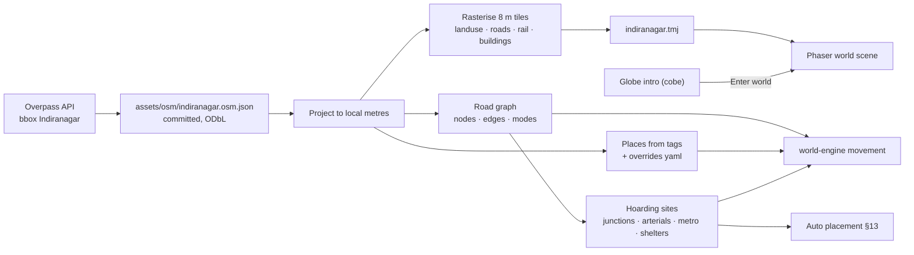

### 5.6 Connection to the main system
The engine moves agents on the road graph and between places. The attention model uses site geometry. Launch Studio's planner chooses among sites. The UI renders the Tiled map and overlays agents, cones and heat.

---

## 6. F3 — Population: agents, personas, relationships, possessions, media diet

### 6.1 Scope
Creating the 1,000 agents once (world genesis) and the special agents. Specs P-01 … P-08.

### 6.2 Design decisions
- **Sampling** (`population.sampler`, seeded) covers age, gender, household type, education, occupation, income band, commute mode and area within Indiranagar. Priors come from public statistics in BigQuery public datasets (Census Bureau IDB, World Bank WDI) and `config/markets/indiranagar.yaml`. Any value that is a **labelled assumption** is marked `assumed: true` and listed in the Guide.
- **Households**: ~400 households placed in residential buildings. Family relationships are created first.
- **Relationship graph**: family, partner, friends (homophily on age, interests, area), colleagues (same workplace), neighbours (same building/lane) and **followers** (agents → reviewer agents by interest). Each edge has a closeness of 0–1 and a channel (meets in person / chats online). Average degree is ~13.
- **Persona core** (Gemini 3.6 Flash, batched): a short bio in the first person, Big Five scores, values, lifestyle cluster, interests, brand attitudes, a speaking style (register, language mix such as English/Kannada/Hindi phrases, verbosity) and a **disclosure style** (how openly they share opinions, money and feelings). Persona fields are validated against the sampled attributes.
- **Routine and media diet**: a weekday/weekend template by occupation, plus app usage (Instagram, YouTube, community, news app), feed sessions (times and minutes), whether they read the newspaper, gym/park habits, a metro or bike commute, and weekend outings.
- **Money**: monthly salary (gig workers are paid weekly), fixed costs, savings, credit card (yes/no and limit) and EMI eligibility. This is used as **affordability**, not as a full ledger.
- **Possessions: phone** (P-06). Brand is drawn from simulated Indian market shares by price band (real brands such as Samsung, Xiaomi, Vivo, Oppo, realme, Apple and OnePlus, labelled simulated). Each phone also gets a model tier (budget/mid/premium/flagship), purchase date (so age), condition (ok/cracked/slow/battery_weak), battery health, satisfaction and a history. **Life events** generate lost/broken/slow events with daily hazards that rise with age and lifestyle.
- **Special agents** (P-08), all part of the 1,000:
  - ~10 **reviewers/influencers** (6 tech, 4 lifestyle) with follower counts
  - ~8 **salespeople** (2 per store)
  - 1 **news desk** agent that posts launch news in the community and the newspaper
- **On-demand category bootstrap** (P-07, stretch). When a product of a new category is launched, such as clothing, Gemini first defines the category's possession schema from the product brief (for example: styles worn, brands, last purchase, monthly spend). It then fills that schema for each agent in batches of 25 compact persona cards, with a plausibility check.

### 6.3 Components
`population/sampler.py`, `households.py`, `relationships.py`, `persona.py`, `routine.py`, `media_diet.py`, `money.py`, `possessions.py`, `life_events.py`, `special_agents.py`, `bootstrap_category.py`, `audit.py`.

### 6.4 Data — the agent record (Firestore `agents/{agent_id}`)
`profile` (immutable after genesis: demographics, persona core, routine template, media diet, money profile, home/work place), `state` (location, activity, needs, mood, current plan), `possessions` (by category), `followers/following`, `watch` flag, `stats` (counters). Relationships live in `relationships/{a}_{b}`. Daily snapshots go to BigQuery as `agent_snapshot` events.

### 6.5 Flow
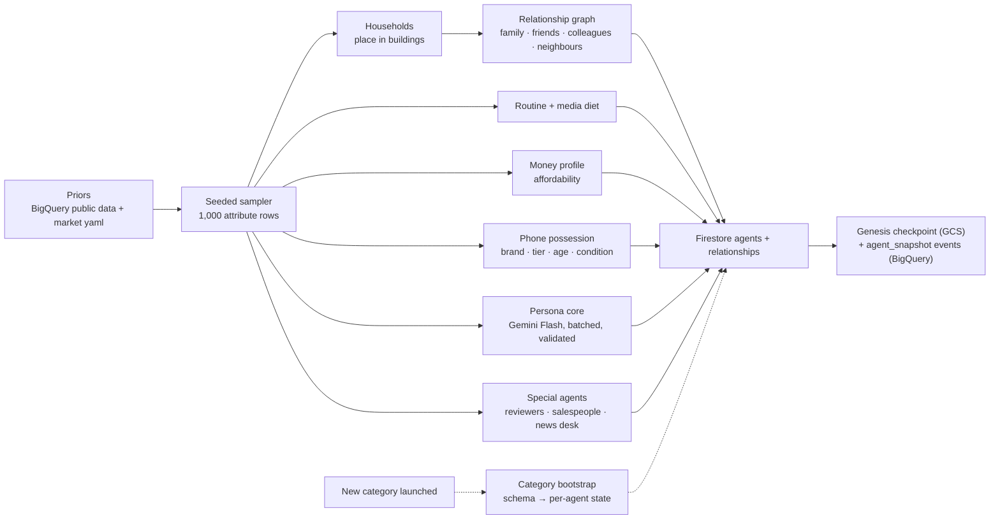

### 6.6 Connection to the main system
The engine loads agents from the genesis checkpoint. Memory starts with **seed memories** (3–6 per agent: job, family, current phone, a recent event). The People page and profiles read these records, and Insights joins on `agents_latest`.

---

## 7. F4 — Always-on engine: clock, day loop, movement, checkpoints, live stream, highlights

### 7.1 Scope
The process that *is* the world. Specs W-05 … W-09, E-01 … E-04, E-06, E-07.

### 7.2 Design decisions
- **Service shape**: `world-engine` is a FastAPI app on Cloud Run with `--min-instances=1 --max-instances=1 --no-cpu-throttling` (CPU always allocated), 2 vCPU and 4 GiB. The world loop starts in the app's lifespan as a background asyncio task. The same instance serves `/live` (WebSocket, session affinity) and `/healthz`.
- **Single writer**: before stepping, the engine takes a **lease** in Firestore `world/lease` (instance id, expiry 60 s, renewed every 20 s). A second instance, for example during a deploy overlap, waits read-only until the lease expires.
- **Clock**: the engine advances **1 sim minute per tick**. At 1 sim day = 1 real hour, that is one tick every 2.5 real seconds. Computation per tick is small, so most of the time goes to awaiting model calls. The clock can be paused, sped up for development (`WORLD_SPEED`) or slowed by the budget governor.
- **Day loop** (E-01), per agent per tick:
  - needs drift (energy/sleep, hunger, social battery, mental fatigue, stimulation)
  - the routine says what should happen now
  - the plan (the agent's "today" list, built at wake-up and updated by intents such as "visit a store", "read reviews", "meet a friend") can override the routine
  - activity transitions emit events
- **Movement** (E-02): A* on the road graph with modes walk / two-wheeler / car / auto / bus / metro (metro between stations). Agents move along edges and produce **movement segments** `{agent, from_xy, to_xy, t0, t1, mode}`. **Heading** is the segment direction. The engine only needs positions at tick resolution; the browser interpolates.
- **Encounters** (E-03): a spatial hash on 16 m cells gives candidate pairs in the same cell, or the same place for ≥ 2 sim minutes, who are not busy. These feed the gate in §11.
- **Event log** (E-04): every change is an `Event` (INTERFACES §2.1).
  - The engine publishes in batches to Pub/Sub `world-events`. A BigQuery subscription writes them to `launch_lens.events`.
  - Texts (thoughts, messages, posts, reviews, episodic summaries) also go to `world-texts` → `launch_lens.texts`, with embeddings.
  - Locally, a DuckDB writer has the same schema.
- **Determinism** (E-06): seeded `numpy.random.Generator` streams per subsystem and per agent, keyed by `(world_seed, day, agent_id, purpose)`. Model results are cached by input hash. Wall-clock latency never changes outcomes: an LLM result is applied at the sim minute it was *requested* plus a fixed sim delay.
- **Async model work**: model calls run as asyncio tasks with a concurrency limit (32). While a conversation is being generated, both agents show "talking" and stand still. When a call finishes, its results are applied deterministically. If a call is still pending after a sim hour, it times out and falls back to a template.
- **Checkpoint/resume** (E-07):
  - Every sim hour (2.5 real minutes), the full engine state is written to `gs://…-ll-worlds/checkpoints/{t}.msgpack.zst`: agent states, positions and segments, pending plans, RNG states, the governor and open sessions. The pointer `world/state.last_checkpoint` is updated.
  - Firestore agent docs are updated in batches each sim hour.
  - On start, the engine loads the latest checkpoint. Events after it are re-derived deterministically, and duplicates are idempotent through `event_id`.
- **Watchdog**: Cloud Scheduler calls `GET /healthz` every 5 minutes. If the loop has not ticked for 2 minutes, `/healthz` returns 500 and Cloud Run restarts the container.
- **Live stream** (W-07): `/live` sends `hello` (sim time, speed, all agent positions + active segments, active bubbles, live products), then `seg` batches, `evt` (bubbles, notices, launches, purchases, posts), `stats` every 5 real seconds and `clock`. About 1,000 agents produce roughly 3–6 KB/s. The browser keeps a 2 s buffer and interpolates.
- **Highlights** (W-08): at the end of each sim day the engine writes `highlights/day-{n}.json`, containing:
  - the top ~40 moments by importance (product chats, notices with thoughts, store inquiries, purchases, viral posts, launches)
  - 10-minute position samples for every agent

  The timeline replays a highlight reel: the camera jumps between moments while the positions are animated.
- **World stats** (W-09): agents, households, relationships, conversations today/total, thoughts today, products live, sim day and time, budget used today.

### 7.3 Components
`engine/clock.py`, `loop.py`, `lease.py`, `needs.py`, `routine.py`, `planner.py`, `movement.py` (A*, segments), `spatial.py`, `encounters.py`, `events.py` (EventBus → Pub/Sub/DuckDB), `checkpoint.py`, `highlights.py`, `live.py` (WebSocket hub), `governor.py`, `rng.py`, `tasks.py` (async model work queue).

### 7.4 Flow — one tick
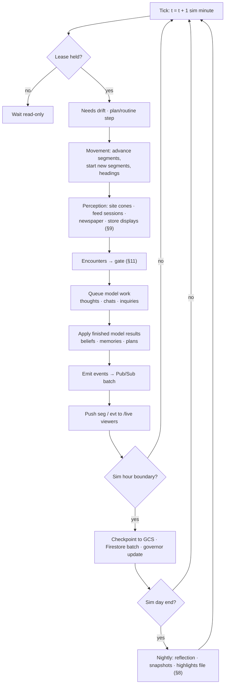

### 7.5 Flow — runtime topology
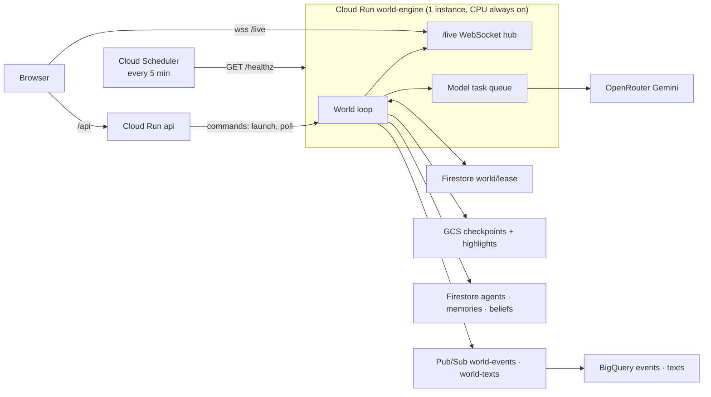

### 7.6 Connection to the main system
Everything that "happens" in the world runs inside this loop: perception (§9), channels (§10), conversations (§11) and buying (§12). The API sends commands (launch a product, start a poll, interview) through an authenticated internal endpoint `POST /commands`, and the engine applies them at the next tick.

---

## 8. F5 — Memory: layered memory, retrieval, reflection, isolation

### 8.1 Scope
How each agent remembers, recalls and forms beliefs, and how its persona is carried into every call. Specs M-01 … M-07.

### 8.2 The layers
| Layer | Where | What | Written by | Read by |
|---|---|---|---|---|
| **L0 Raw log** | BigQuery `events`, `texts` | Every perception, thought, message (exact text), share plan, debrief, post, inquiry, purchase, belief change; immutable | EventBus | Insights, audits, evals; never loaded into agent prompts wholesale |
| **L1 Working memory** | Engine RAM | Today: current activity, plan, last ~20 observations, open intents, mood, needs | Day loop | Every agent prompt (compact) |
| **L2 Episodic memory** | Firestore `agents/{id}/memories` (vector index, 768-d) | First-person summaries of episodes: "Saw a huge Nova X1 billboard at the metro; the night photos looked unreal." Each has `importance` 1–10, `kind`, `source` (channel, site, person), `entities` (products, people), `t`, `event_refs` | Thought step, debriefs, purchases, life events | Retrieval for that agent only |
| **L3 Beliefs** | Firestore `agents/{id}/beliefs/{subject}` | Per product, brand or category: awareness, attitude −1…+1, confidence, reasons for/against (top 3 each), first heard via `{channel, t, ref}`, sources seen, consideration stage, open questions | Thought step, debriefs, reflection, inquiries | Prompts (relevant subjects), planner, Insights snapshots |
| **L4 Persona core** | Firestore `agents/{id}.profile` | Who I am: bio, Big Five, values, lifestyle, interests, speaking and disclosure style, money profile, possessions | Genesis (+ category bootstrap) | Every prompt as the **persona card** |
| **L5 Reflection** | L2 entries of kind `reflection` + belief updates | Nightly consolidation: 1–3 insights about self, others and products; memories decayed and pruned | Nightly job | Retrieval |

### 8.3 Retrieval (M-03)
`score = 0.35·recency + 0.25·importance + 0.40·relevance`
- **recency** = 0.995^(sim hours since the memory)
- **importance** = importance / 10
- **relevance** = cosine similarity between the query embedding and the memory embedding

The query is built from the situation: who I'm with, what I see, the product or topic. The top k = 6 memories are returned, always **filtered by `agent_id`** at the store layer. Firestore vector search uses `find_nearest` with a pre-filter on `agent_id`, then re-ranks with the full score. A per-agent LRU cache of embeddings in engine RAM serves hot agents.

### 8.4 Persona card and context assembly (M-06)
Every agent prompt is assembled by `mind.context.build(agent, purpose, query)` from:
1. **persona card**: about 150 tokens, fixed per agent, cacheable
2. **now**: time, place, activity, mood, needs
3. relevant **beliefs** (≤ 3 subjects)
4. top-k **episodic memories**
5. the **stimulus** (creative description, a message, a question)

The total is capped at about 900 input tokens for engine calls. Nothing from any other agent's private layers can enter. The only thing that crosses between agents is **public text**: messages actually spoken, posts actually published and reviews actually released.

### 8.5 Reflection and pruning (M-05)
Each sim night (03:00), agents whose summed episode importance today is at least 12 reflect. That is ~100–150 agents per day, and the budget governor sets the cap. A Flash-Lite call with the day's episodes and current beliefs returns reflections, belief updates and memories to forget. Pruning keeps the top **300** episodic memories per agent by `importance × recency`. Pruned memories are **not deleted** from L0, so the raw log is always complete.

### 8.6 Isolation and private/public channels (M-07)
- `MemoryStore(agent_id)` can only read and write that agent's memories and beliefs (enforced in code and covered by tests).
- `SessionRegistry` locks participants during conversations.
- Prompt builders take an `AgentContext` object. A shared prompt builder (dialogue) only accepts `SharePlan` objects (public by type).
- **Marker-fact tests**: a unique fact planted in agent A's private memory must never appear in any output involving agent B unless A said it out loud.

### 8.7 Flow — write path
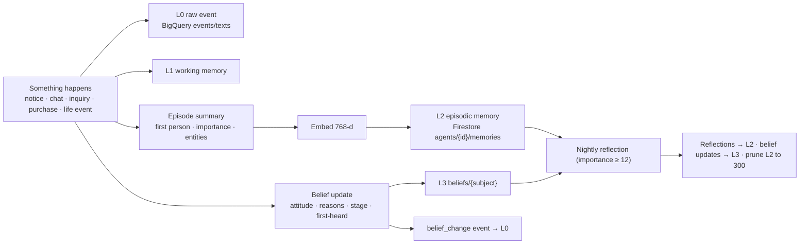

### 8.8 Flow — read path for one agent prompt
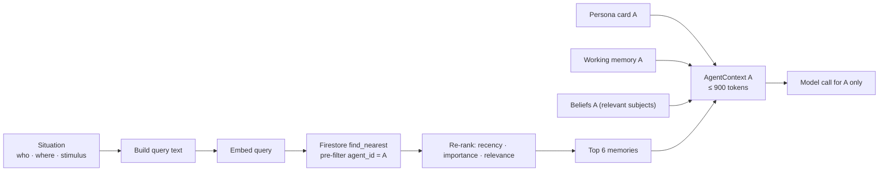

### 8.9 Connection to the main system
Every model call about an agent (thoughts, chats, inquiries, polls, interviews) goes through `mind.context.build`. Insights reads L0 (SQL and vector search) and L3 snapshots. The profile drawer shows L2, L3 and the agent's own L0 slices (its thoughts and its conversations).

---

## 9. F6 — Perception and attention: hoardings, feeds, print

### 9.1 Scope
When an agent is exposed to an ad, whether it passes by, glances or notices, what it thinks, and how hoarding performance is measured. Specs A-01 … A-06.

### 9.2 Design decisions
- **Exposure geometry (A-01)** for a hoarding at position `s` with facing unit vector `f` (pointing towards its audience). An agent at `p` with heading `h` has an **opportunity to see (OTS)** when all of these hold:
  1. it is in front of the face: `(p − s)·f > 0`
  2. it is inside the cone: `angle(p − s, f) ≤ cone_half_angle`
  3. it is in range: `|p − s| ≤ max_distance`
  4. it is looking roughly forward: `angle(h, s − p) ≤ 55°` (wider when stationary)

  **Dwell** is the sim-seconds spent inside the cone (from the movement segment), and **mode** is walk, two-wheeler, car, bus or metro. A night OTS only counts if the board is `lit`. One OTS is counted per agent per site per pass.
- **Attention model (A-02)** is deterministic, seeded and costs no model call:
  `p_glance = σ(a0 + a1·log(area/dist²) + a2·dwell + a3·lit_night + a4·salience − a5·clutter − a6·on_phone − a7·fatigue − a8·driving)`
  `p_notice|glance = σ(b0 + b1·relevance + b2·novelty + b3·attitude_prior + b4·clarity + b5·brand_familiarity + b6·need)`
  - **salience** and **clarity** come from the creative's understanding (§13).
  - **relevance** combines interests, category need and the target-persona match.
  - **novelty** decays with repeat exposures; wear-out applies after ~8 notices (A-05).
  - Default coefficients aim for roughly 30–40% glance and 4–10% notice of OTS. These are **labelled assumptions** in `config/attention.yaml`, shown in the Guide and tunable.
- **Feed (A-04)**: in each feed session (from the media diet), the feed ranker draws N items: friends' posts (template), reviewer content, campaign reels for matched audiences, and baseline ads. For each item, scroll past / partial watch / full watch is decided by the same attention form, with features for hook strength, length, interest match and session fatigue. A full or partial watch counts as **notice**.
- **Print (A-04)**: agents who read the newspaper see that day's print ads. Attention depends on ad size and page position.
- **Thought on notice (A-03)**: one Flash-Lite call with `AgentContext(purpose="ad_thought")` and the creative's description (not the raw image, to save tokens) returns: `thought` (first person, ≤ 2 sentences), `why_noticed`, `attitude_delta`, `reasons_for/against`, `open_questions`, `intent_change`, `wants_to_tell` (people/topic), `importance`. The thought is **private**. It becomes an L2 memory and an L3 belief update, and is logged as `thought` (L0, plus `texts`).
- **Every exposure outcome is logged**, including pass-bys (`exposure` events with outcome `pass|glance|notice`), so hoarding metrics are exact.
- **Budget**: when the governor caps ad thoughts, the extra notices still update beliefs from a small deterministic rule (attitude nudged by salience and relevance), are logged with `rendered=false`, and get a template memory ("Noticed the Nova X1 billboard on 100 Feet Road").

### 9.3 Hoarding metrics (A-06)
Each metric is computed per site × facing × product × day, and by segment and hour:

| Metric | Definition |
|---|---|
| OTS | Opportunities to see |
| Glance rate | glances / OTS |
| Notice rate | notices / OTS |
| Thoughts | Number of thoughts logged |
| Sentiment | Mean attitude delta |
| Top themes | Clustered reasons from thoughts |
| Target share | Share of OTS from target personas |
| Cost per notice | Simulated rate card ÷ notices |

These are exposed as the `v_site_daily` view and the Hoardings tab (§14).

### 9.4 Flow
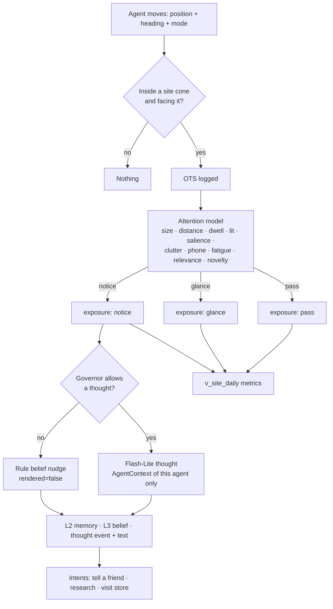

### 9.5 Connection to the main system
Channels (§10) produce the exposures and the engine loop calls perception every tick. Thoughts feed conversations (topics people want to tell), the planner (research/visit intents) and Insights (hoardings, sources, segments).

---

## 10. F7 — Channels

### 10.1 Scope
How a product reaches agents: hoardings, reels, newspaper, reviewers, community, store displays, word of mouth and baseline ads. Specs C-01 … C-08.

### 10.2 Design decisions
| Channel | Mechanism | Public/private split logged |
|---|---|---|
| **Hoardings & bus shelters** (C-01) | Sites from the auto plan show the product's creative from launch for the flight length (default 21 sim days, renewable) | Exposure → thought (private) |
| **Reels / video feed** (C-02) | A creative = transcript + scene list + optional thumbnail. Audience rules come from target personas (interests, age band, lifestyle, area). Daily impression budget and frequency cap (3/day). Ranked into feed sessions; **interested agents see it more** (interest match boosts ranking) | Watch → thought |
| **Newspaper** (C-03) | A daily edition with print ads (size, page). The news desk agent adds a launch news item | Read → thought |
| **Reviewers** (C-04) | At launch, matching reviewer agents receive a unit. Over 1–3 sim days each forms a **private opinion** (Flash with product facts + their persona and biases), then **publishes** a review (title, transcript summary, rating, pros/cons) that enters followers' feeds and is cited in the community | private_opinion vs review |
| **Community** (C-05) | Reddit-style forums `r/IndiranagarLife`, `r/BangaloreTech` (`r/BangaloreStyle` when clothing arrives). Threads come from the news desk, reviewers and agents. Agents with the community in their media diet read the top threads in a session (attention → private thought) and may **upvote / comment / post** (the decision model decides; Flash-Lite writes the public text) | thought vs post/comment |
| **Store displays** (C-06) | In stores that stock the product: display creative and demo unit; exposure when the agent is in the store | Exposure → thought |
| **Word of mouth** (C-07) | Conversations (§11) where product talk is in a share plan; first-heard attribution can be `wom:{agent_id}` | Share plan vs debrief |
| **Baseline ads** (C-08) | Before and alongside launches, other fictional brands (food delivery, bank, streaming, fashion) occupy some sites and feeds, so attention is realistic and the world has ambient advertising | Same |

### 10.3 Flow
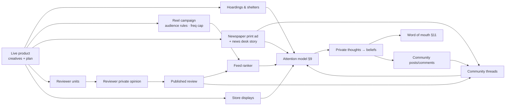

### 10.4 Connection to the main system
Launch Studio (§13) produces the creatives and plan. The engine runs each channel inside the tick. All outcomes become events. Insights → Sources computes first-heard and path statistics per channel.

---

## 11. F8 — Conversations: encounter gate, think/speak, store inquiries

### 11.1 Scope
Who talks to whom, what they say, what they keep to themselves, and how every conversation is logged and remembered. Specs T-01 … T-07.

### 11.2 Design decisions
- **Gate (T-01)**:
  1. **Rules**: both available, not already in a session, co-located ≥ 2 sim min, cool-down per pair.
  2. **Who**:
     - people who know each other (relationship edge) talk with a probability that rises with closeness and free time
     - strangers only in stores, queues, bus stops and cafés, and only briefly (T-05)
  3. **Decision model** (typed, batched): `{talk: bool, topic_candidates[]}`. Topics come from **shared interests ∩ salient memories**: recent notices, open questions, life events, purchases. **Product talk only happens if at least one side has the product salient and the other is interested in the category, or they share the interest.**
  4. **Priority & budget**: priority = product-related + watched agent + closeness. If the governor allows, the chat is *rendered*. Otherwise it is logged as an **unrendered interaction** (topic tag, duration, template memory) (T-07).
- **3-step conversation (T-02)**, rendered:
  1. **Private prep**, a separate call for each agent, with only that agent's context. Flash-Lite lists **candidate thoughts** relevant to this person and topic, each tagged sensitive/personal/opinion/question. The **decision model** then selects what to say, based on closeness, disclosure style, topic sensitivity and mood. The output is a **SharePlan** `{opening, points_to_share[], questions_to_ask[], withheld_count, tone}`. The withheld items stay private and are logged as `share_plan` with `private=true` for that agent only.
  2. **Dialogue**, one call that receives **only the two SharePlans**, the speaking styles, the relationship ("college friends, close") and the place. It writes **up to 10 messages per person (≤ 20)**: it opens with a greeting, follows the share plans, and ends naturally. Product-related chats use Flash; small talk uses Flash-Lite. Output: `messages[{speaker, text}]`, `topics[]`, `product_mentions[]`.
  3. **Private debrief**, a separate call for each agent, with that agent's context plus the **transcript**. It returns a private reaction, belief deltas, an episodic summary ("Ravi says the Nova X1 camera is amazing, but he hasn't used it himself"), importance and new intents.
- **Store inquiry, turn by turn (T-03)**:
  - **Customer turn**:
    - *think*: Flash-Lite writes a private thought about what was just said, plus candidate things to say
    - *decide*: the decision model picks whether to speak, what to say, and what to hold back (budget, real intent)
    - *speak*: Flash-Lite turns the chosen item into one utterance
  - **Salesperson turn**: an ADK salesperson agent sees only the **spoken transcript**, the product facts (`product_facts`, `stock`, `offers` tools) and its own persona and memory. It may demo or explain features. Its own private thought is logged separately.
  - The visit ends after ≤ 10 messages each, or when the customer decides to leave or buy.
  - Customer debrief: belief update, `inquiry` event (questions asked, topics, answered?, satisfaction, outcome: leave / think about it / buy).
  - The salesperson never receives the customer's thoughts.
- **Transcripts (T-04)**: every rendered message is a `message` event (`session_id`, `seq`, `speaker`, `listener`, `text`) plus a `texts` row with an embedding, plus a `conversation` summary event. Each participant gets its **own** L2 episodic summary from its debrief.
- **Sessions (T-06)**: `SessionRegistry` assigns a `session_id`, locks participants (no other chat), and releases them on end or timeout. In the UI the two agents stop and face each other, and a speech bubble shows the opening line.
- **Unrendered interactions (T-07)**: `interaction` events (topic, minutes, rendered=false) keep social life and relationship strength realistic when the budget is tight.

### 11.3 Flow — rendered social conversation
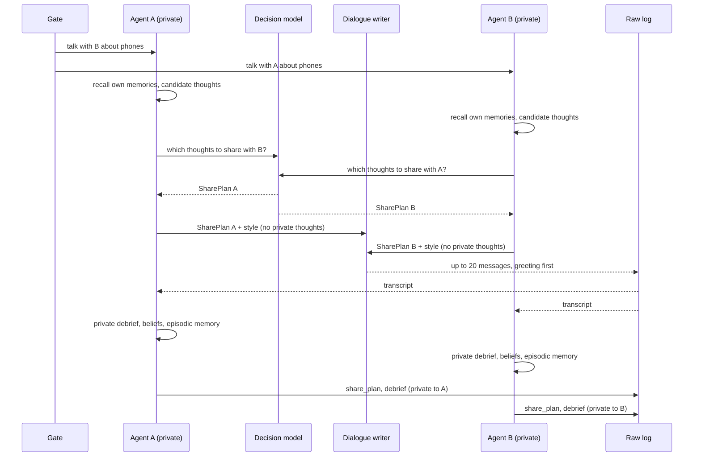

### 11.4 Flow — store inquiry, turn by turn
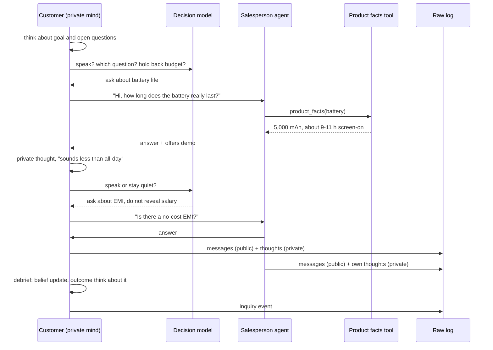

### 11.5 Connection to the main system
Conversations consume memories (§8) and produce messages, beliefs and intents. Store inquiries are part of buying (§12). Insights → Conversations analyses topics, sentiment and the **public vs private gap** (what people said versus what they privately thought).

---

## 12. F9 — Needs, consideration and buying

### 12.1 Scope
How an agent decides to research, inquire or buy, without anyone predicting it. Specs S-01 … S-06.

### 12.2 Design decisions
- **Need (S-01)** per category, from 0 to 1. For phones it depends on age (years), condition, battery health, lost/broken flags, satisfaction and job dependence. Life events (lost/broken/slow) push need up suddenly. Clothing, once bootstrapped, uses its own drivers (occasion, wardrobe age, festival season).
- **Interest (S-02)** per product, from 0 to 1. It combines belief attitude and confidence, awareness, social proof (friends' expressed attitudes heard in chats), reviewer rating seen, fit (features ↔ interests and needs) and price fit (income, savings, card/EMI).
- **Opportunity (S-03)**: a store on today's route, a weekend, payday within 3 days, a feed or community research session, or a friend's invitation.
- **Consideration state machine** per agent × product: `unaware → aware → curious → researching → inquiring → deciding → purchased | postponed | rejected`. Transitions are evaluated at wake-up planning and after each belief update. The rules are in `config/consideration.yaml`, and the decision model breaks ties.
- **Planning**: *researching* adds "read reviews / browse community" to feed sessions. *Inquiring* adds "visit store X" to today's plan: the nearest store that stocks the product, or the online store ShopKart for online-first agents. The agent's open questions become the customer's agenda in the store.
- **Purchase (S-05)**: only when **need ≥ θ_need**, **affordability** holds (cash, card limit or EMI eligibility), and the preferred option's margin over alternatives is ≥ δ. The option can be one of *our launched products* or the **baseline market** (S-06: generic current models of the real brands they know, by tier). The decision model makes the typed choice `{buy:<product|baseline>, method: cash|card|emi} | postpone | not_buying`. A purchase updates possessions (new phone, age 0) and money, and is logged.
- **No per-person prediction.** Insights computes **likely-buyer segments** from need, interest, stage and affordability (§14).
- **Stores (S-04)**: fictional multi-brand stores (Digital Bazaar on 100 Feet Road, ElectroHub on CMH Road, PhoneWorld on 12th Main) and the online store ShopKart. Each stocks launched products (as set in Launch Studio) and the baseline market. Each physical store has 2 salesperson agents on shifts.

### 12.3 Flow
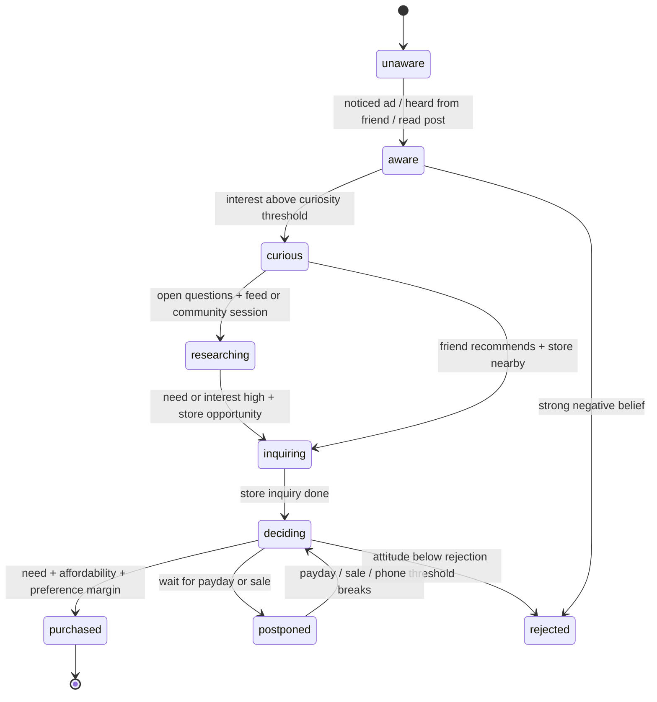

### 12.4 Connection to the main system
Beliefs (§8) drive interest. Life events and possessions (§6) drive need. Store visits use conversations (§11). Purchases and inquiries power Insights → Overview, Sources and Segments.

---

## 13. F10 — Launch Studio: products, content, understanding, auto placement, launch moment

### 13.1 Scope
Defining several products, understanding their content, planning automatically, marking them ready, and launching them into the live world. Specs L-01 … L-08, P-07.

### 13.2 Design decisions
- **Products (L-01)** are documents: `{product_id, name, brand, category, price_inr, launch_offer (EMI etc.), features[], claims[], target_personas[], strategy {goal, key_message, channels[], flight_days, intensity: low|medium|high}, content[], stores[], status: draft|ready|live|ended, launched_at_t}`. Multiple products can be drafted and ready at the same time.
- **Content (L-02)**: hoarding poster, bus-shelter poster, reel (transcript + scenes + thumbnail), social post, newspaper ad, store display, reviewer kit (spec sheet + key claims). Images are uploaded to GCS through signed URLs. **Model Armor** screens all text and extracted text. Content is treated as data, never as instructions.
- **Understanding (L-03)**:
  - an ADK *understanding* agent (Flash, multimodal) extracts the product profile (claims linked to source sentences, entities, target hypothesis)
  - the *claim risk scanner* (Pro) rates each claim red/amber/green
  - *creative understanding* (Flash) turns each asset into a **StimulusRecord**: salience, clarity, hook, claims carried, emotional tone, readable at distance?, and a 2-sentence description used in agent prompts
- **Knowledge graph (L-04)**: nodes are product, features, claims, concerns, competitors, audience segments, creatives, brand and stores. It is shown with an **Obsidian-style interactive graph** (d3-force + canvas). Thought and message texts are later linked to nodes by embedding similarity, which powers "which claims people actually talk about".
- **Target personas (L-05)**: free text and chips → Gemini compiles them into **audience rules** (filters over agent attributes and interests) → live audience counts. Personas **aim** the plan. They never create or alter agents.
- **Auto placement (L-06)**, fully automatic:
  1. **Traffic model**: from the last 7 sim days of movement, count OTS per site × facing × hour × segment, so the world's own foot traffic is the data.
  2. **Score** per candidate = expected target OTS × (glance prior from size, lit, clutter) × time-of-day fit ÷ rate card. A diversity penalty applies within 150 m.
  3. **Select** k sites by intensity (low 4, medium 8, high 12) with a greedy max-coverage of distinct target agents. Sites already held by another live product are excluded (first come).
  4. **Gemini (Flash)** writes one reason per site, for example: "Faces outbound evening traffic from tech offices on 100 Feet Road; ~1,240 target OTS/day."
  5. Plan for the other channels: reel audience size and impressions/day, newspaper insertion days, reviewer assignment (by category and follower overlap with the target), community seeding (news desk post), and stores stocking it.
  6. The plan is **read-only** in the UI and stored as `plan` on the product.
- **Ready & launch dock (L-07)**: products marked ready appear in the World's dock. Launches happen **one at a time**.
- **Launch moment (L-08)**:
  - The API sends `launch(product_id)`. The engine stamps `launched_at_t`, activates the plan at the next tick, emits a `launch` event, and broadcasts it on `/live`.
  - The browser plays a **firework drop**: an orb falls onto the city, bursts, and particles stream to every planned site (which flips to the creative), to the stocking stores, and as sparkles over the agents whose feeds will receive the reel.
  - The ticker shows a summary, for example "Nova X1 launched · 8 hoardings · 3 stores · reels to ~420 agents · 4 reviewers".
- **New category (P-07, stretch)**: launching a product whose category has no possession schema first runs the category bootstrap (§6), shown as "Preparing the world for clothing… (about 2 min)".

### 13.3 Flow
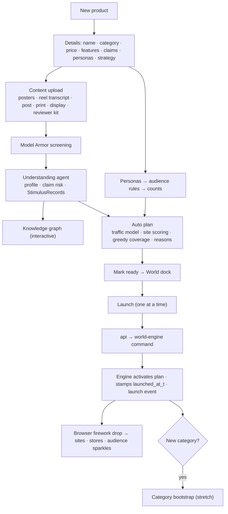

### 13.4 Connection to the main system
The engine reads live products, plans and StimulusRecords every tick (channels §10, attention §9). The knowledge graph links back into Insights. The products list drives the per-product colours, lenses and comparisons everywhere.

---

## 14. F11 — Insights: Ask assistant, dashboards, hoardings, segments, polls, interviews

### 14.1 Scope
Answering any question over what the world has accumulated, plus ready-made views. Specs I-01 … I-09.

### 14.2 Design decisions
- **Curated data layer**: BigQuery views over `events`/`texts`:
  - `agents_latest`: demographics, income band, lifestyle, phone brand/tier/age, media diet
  - `beliefs_latest` and `beliefs_daily`
  - `v_exposures`, `v_site_daily`, `v_thoughts`, `v_messages`, `v_conversations`, `v_inquiries`, `v_purchases`, `v_posts`, `v_reviews`
  - `v_first_heard`, `v_paths`, `v_funnel_daily`

  A **data dictionary** (`insights/dictionary.yaml`) describes every column in plain words, with examples.
- **Ask assistant (I-01)**: an ADK agent on **Gemini 3.1 Pro** with these tools:
  - `describe_data()` → dictionary
  - `run_sql(sql)` → read-only on the curated views only, dry-run first, `maximum_bytes_billed` cap, 5,000-row limit, run as `ll-analyst-ro`
  - `semantic_search(text, filters, k)` → BigQuery `VECTOR_SEARCH` on `texts` (filters: product, kind, cohort, time)
  - `cohort(filter_expr)` → agent ids + size (for example `phone_age_years > 5`)
  - `likely_buyers(product, group_by)` → segment table (I-05)
  - `poll(question, options, cohort?)` → asks agents now (I-07, confirmation required, uses the world budget)
  - `interview(agent_id, question)` → interviewer agent (I-08)
  - `chart(spec)` → ECharts spec

  The output schema is `{answer_md, numbers[{label, value, source_ref}], charts[], quotes[{agent_id, name, kind, t, text, private:bool}], sql[], caveats[]}`.
- **Faithfulness (I-09)**: every number must come from a tool result (checked by matching `source_ref`). Quotes are verbatim from `texts`. If a check fails, the answer is regenerated once, otherwise the claim is dropped. Answers carry the "Simulated" label and the sim-time window.
- Example question: "People with phones older than 5 years — are they interested in any of our phones?"
  1. `cohort(phone_age_years > 5)` → 187 agents
  2. `run_sql` joins `beliefs_latest` → share curious+ per product
  3. `semantic_search` restricted to the cohort and products → top reasons with quotes
  4. `chart` → bar chart
  5. answer + caveats (sample size, sim days observed)
- **Dashboards**:
  - **Overview (I-02)**: per-product awareness, positive attitude, considering, inquiries and purchases over sim days, with launch markers
  - **Sources (I-03)**: first-heard channel, and paths such as hoarding → friend chat → store
  - **Hoardings (I-04)**: site leaderboard (OTS, glance %, notice %, thoughts, sentiment, cost/notice), facing comparison, hour-of-day heat, segment mix, map heat, and the "best real junctions" summary for OOH media owners
  - **Segments (I-05)**: the likely-buyer score `L = need × interest × affordability × stage_weight`, aggregated by age band × income band × lifestyle, with top reasons from thoughts
  - **Conversations (I-06)**: topics, sentiment, claims mentioned, the **public vs private gap**, community threads and reviewer opinion vs review
  - **Polls (I-07)**: the decision model answers for each agent from its persona card + beliefs + top memories, batched 32 per call. The result shows a distribution, a segment heat table and quotes
  - **Interview (I-08)**: an ADK interviewer *as* agent X, grounded only in X's memory (`recall` tool filtered to X); Model Armor screens the questions
- **Interactive budget**: Insights has its own cap ($5/day). Polls show the estimated cost before running.

### 14.3 Flow
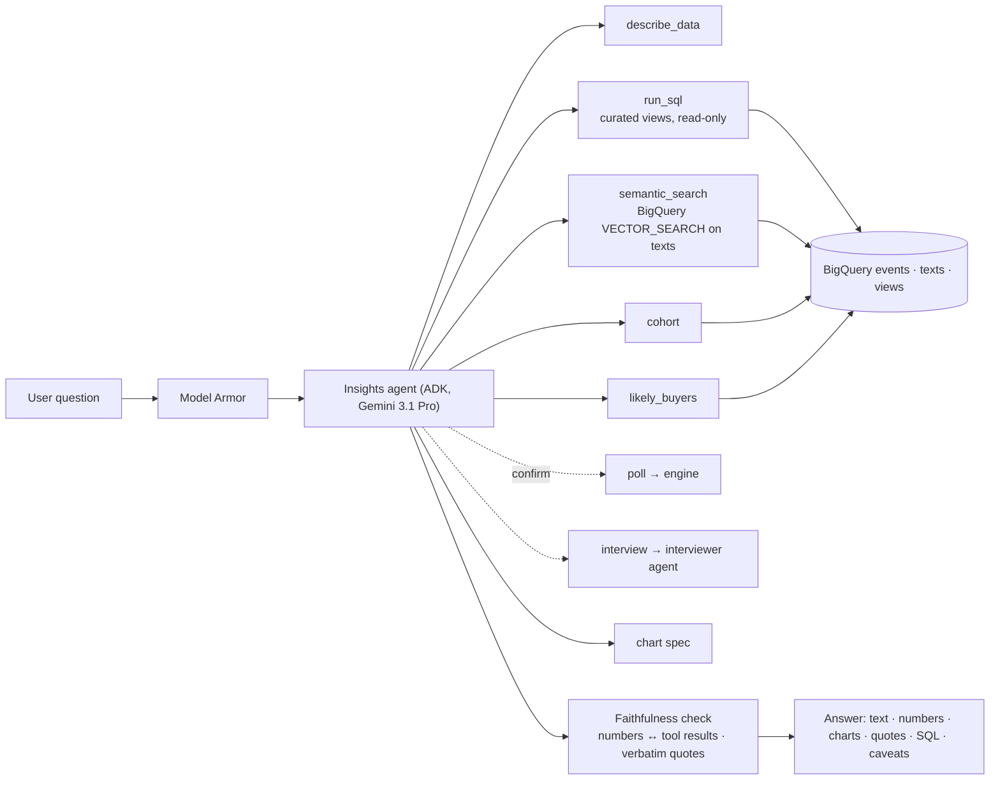

### 14.4 Connection to the main system
Insights only reads, except for polls and interviews, which go through the engine and agent memory. The dashboards are the same SQL the assistant can call, so the assistant and the dashboards never disagree.

---

## 15. F12 — World UI: globe, world view, profiles, people, highlights

### 15.1 Scope
What the user sees and touches. Specs U-01 … U-09, W-01, W-07 … W-10.

### 15.2 Design decisions
- **Routes**: `/` (globe intro on first visit in a session, then `/world`) · `/world` · `/launch` and `/launch/:productId/:step` · `/insights/:tab` · `/people` · `/guide`.
- **World page** (no campaign controls):
  - full-bleed Phaser canvas
  - stats bar
  - lens switch: Activity / Product awareness / Sentiment / Hoardings (cones + heat) / Night preview
  - **New product** button (→ Launch Studio) and the **Ready to launch** dock
  - right panel (340 px) with tabs *Happening now* (ticker), *Watching* (watchlist) and *Products* (live products with awareness bars)
  - bottom **day timeline** (Live / highlights of past days) and minimap
- **Hover card**: name, age, job, current activity, phone (brand, age), relevant belief chips, and "Click for profile".
- **Profile drawer** (420 px) with tabs:
  - Overview: bio, personality, lifestyle, routine, needs, money
  - Relations: list + mini graph
  - Possessions: phone details + history, other categories
  - **Thoughts**: private thought log with triggers
  - **Conversations**: list → full transcript, with this agent's private prep and debrief shown beside it
  - **Memory**: episodic list + belief cards per product

  Plus a ☆ Watch toggle.
- **People page**: a table of all agents with search and filters (age, job, income band, phone age, product awareness/stage), sortable, with the watchlist.
- **Launch Studio**: product cards (Draft/Ready/Live) and an editor with steps Details → Content → Understanding → Plan → Ready.
- **Insights**: tabs Ask · Overview · Sources · Hoardings · Segments · Conversations · Polls · Interview.
- **Live rendering**: the client keeps per-agent segment queues and interpolates at 60 fps. Speech bubbles come from `evt` messages, and lenses are computed client-side from belief snapshots sent in `stats`. Highlights mode loads `highlights/day-n.json` and plays a reel.
- **Visual-test mode**: fixtures replace `/live` and `/api`. The globe canvas, world canvas and graph canvas are hidden in gated comparisons and reviewed by eye.

### 15.3 Flow
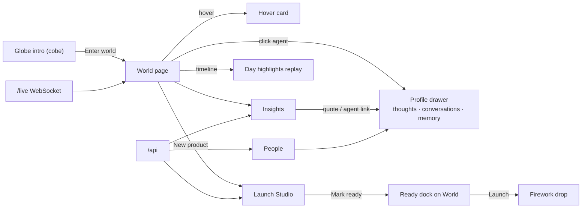

---

## 16. End-to-end architecture

### 16.1 Main system diagram
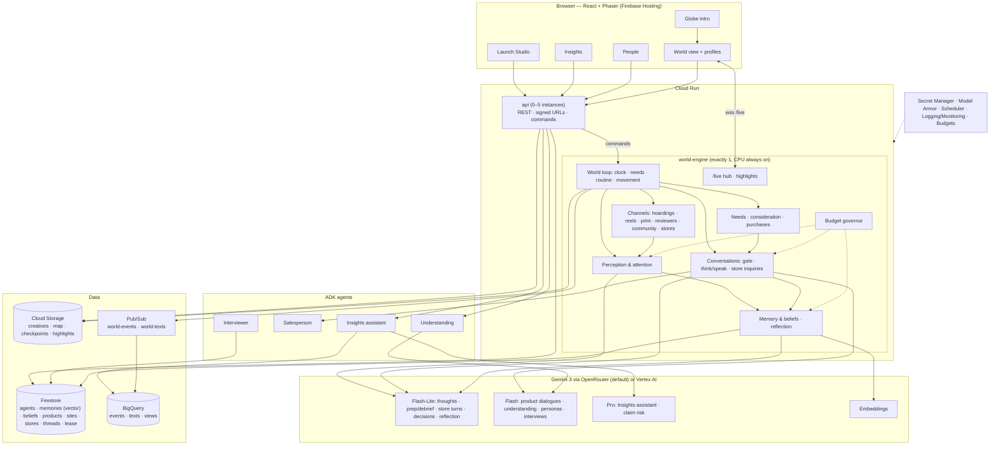

### 16.2 How the features plug in
| Feature | Plugs in at | Contract |
|---|---|---|
| F1 foundation | Everywhere | `shared.*`, INTERFACES §2–3 |
| F2 world | Engine startup, UI map, planner | `places.json`, `sites.json`, `roadgraph.json`, `.tmj` |
| F3 population | Genesis checkpoint | `Agent` schema |
| F4 engine | Owns the clock and all state changes | `Event`, `/live` protocol, `/commands` |
| F5 memory | Every agent prompt | `MemoryStore`, `AgentContext` |
| F6 attention | Every tick | `Exposure`, `Thought` |
| F7 channels | Every tick for live products | `Product.plan`, `StimulusRecord` |
| F8 conversations | Encounters each tick | `SharePlan`, `Message`, `Inquiry` |
| F9 buying | Wake-up planning and belief updates | `Consideration`, `Purchase` |
| F10 Launch Studio | `api` + launch command | `Product`, `Plan` |
| F11 Insights | Reads BigQuery; polls/interviews via engine | Views, tool schemas |
| F12 UI | Reads `/live` + `/api` | `data-testid`, `window.__ll` |

### 16.3 Lifecycles
**A sim day (1 real hour):**
- **06:00–08:00**: agents wake, plan their day (planner adds research/visit intents), read the newspaper (print exposures), scroll feeds.
- **Commute**: movement past hoardings (OTS → glance/notice → thoughts), metro panels, bus shelters.
- **Work and lunch**: colleagues talk at lunch (gate → 3-step chats), feed sessions.
- **Evening**: errands, store visits (turn-by-turn inquiries), cafés with friends, gym and park.
- **Night**: feed and community browsing, posts, sleep.
- **03:00**: reflection, belief snapshots, highlights file, daily rollups.

**A launch:**
Studio (details → content → understanding → auto plan → ready) → World dock → Launch → engine activates the plan (sites flip, reels enter feeds, reviewers receive units, the news desk posts, stores stock it) → over the following sim days awareness spreads through notices, reviews, community and word of mouth → inquiries and need-driven purchases.

**A question:**
Insights → Model Armor → assistant → tools over BigQuery views (+ vector search) → faithfulness check → answer with charts, quotes and SQL → click a quote → that agent's profile, opened at the exact conversation.

### 16.4 Data architecture
| Store | Collection / table | Contents | Retention |
|---|---|---|---|
| Firestore | `world/state`, `world/lease` | Clock, speed, status, last checkpoint, budget today; single-writer lease | Live |
| Firestore | `agents/{id}` | Profile, state summary, possessions, money profile, watch flag | Live |
| Firestore | `agents/{id}/memories/{mid}` | Episodic memory + `embedding` (vector, 768) | Pruned to 300/agent |
| Firestore | `agents/{id}/beliefs/{subject}` | Current beliefs | Live |
| Firestore | `relationships/{a}_{b}` | Type, closeness, last interaction | Live |
| Firestore | `products/{pid}` (+ `creatives/{cid}`) | Product, StimulusRecords, plan, status | Permanent |
| Firestore | `sites/{sid}`, `stores/{sid}`, `threads/{tid}` (+ `comments`) | Inventory, stores, community | Live |
| Firestore | `watchlist/{uid}`, `insight_sessions/{sid}` | UI state, assistant chats | Live |
| GCS | `…-ll-uploads/` | Creatives, kits | Permanent |
| GCS | `…-ll-worlds/genesis/`, `checkpoints/`, `highlights/` | Engine state, day highlights | Checkpoints: keep last 48 + daily |
| BigQuery | `events` | Every event (partitioned by `DATE(t_real)`, clustered `kind, agent_id`) | Permanent |
| BigQuery | `texts` | Thought/message/post/review/episode texts + `embedding` | Permanent |
| BigQuery | views | Curated analysis layer (§14) | — |

### 16.5 Entity relationships
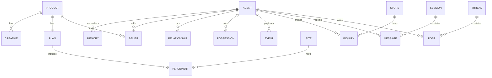

### 16.6 API surface (details in INTERFACES §5)
- `GET /world/state`, `GET /world/stats`, `GET /world/highlights/{day}`
- `GET /agents?filters`, `GET /agents/{id}`, `GET /agents/{id}/thoughts|conversations|memories|beliefs`, `GET /conversations/{session_id}`
- `POST/GET/PATCH /products`, `POST /products/{id}/uploads` (signed URL), `POST /products/{id}/understand`, `POST /products/{id}/plan`, `POST /products/{id}/ready`, `POST /products/{id}/launch`
- `POST /insights/ask` (streams), `GET /insights/{tab}` (dashboard data), `POST /insights/poll`, `POST /insights/interview`
- `PUT /watchlist`, engine `POST /commands` (internal, IAM-authenticated), engine `GET /live` (WebSocket), `GET /healthz`

### 16.7 Deployment topology
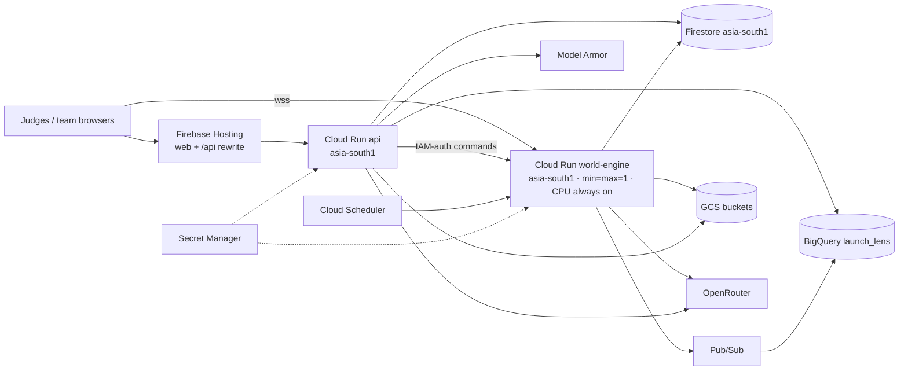

---

## 17. Budget governor and cost model

**Target**: $15 per real day for the background world = **$0.625 per sim day** at 1 sim day per hour.

| Work (per sim day, 1,000 agents) | Model | Default cap | Approx. cost (standard) |
|---|---|---|---|
| Ad thoughts (noticed only) | Flash-Lite | 220 | $0.11 |
| Product-related chats (3-step) | Flash dialogue + Lite prep/debrief | 20 | $0.18 |
| Social chats (3-step) | Flash-Lite | 30 | $0.18 |
| Store inquiries (turn-by-turn) | Flash-Lite + decisions | 6 | $0.10 |
| Reflection | Flash-Lite | 120 | $0.13 |
| Decision batches (gate, share plans, planning, community) | Flash-Lite | as needed | $0.10 |
| Reviews, community posts | Flash / Lite | 15 | $0.02 |
| Embeddings | embedding-001 | all texts | < $0.01 |
| **Total** |  |  | **≈ $0.82** (≈ $0.45 on flex endpoints) |

**How the governor works**:
- **Priority classes**: P0 store inquiries and watched agents · P1 ad thoughts · P2 product chats · P3 reflection · P4 social chats · P5 community posts.
- **Each sim hour** it compares actual spend (OpenRouter usage cost) to the plan and sets hourly caps per class from the bottom up.
- If P0–P2 alone would exceed the budget, it **slows time** in steps (1 day/h → 1 day/1.5 h → 1 day/2 h → 1 day/3 h) and shows "Slowed to save budget".
- Over-cap work becomes `rendered=false` with rule-based updates and template memories, so the world never stops, only gets less verbose.
- Night hours and quiet periods cost almost nothing.

**Other levers**: prompt caching of persona cards; batching of decisions (32/call); dedup of identical stimuli; low reasoning effort; `max_tokens` limits; flex endpoints when available.

**Infrastructure** (rough, per month):
- `world-engine` always-on (2 vCPU, 4 GiB): ~$100–150 (covered by credits)
- `api` scales to 0
- Firestore, BigQuery, GCS, Pub/Sub: < $20 at this volume
- Budget alerts are on (setup guide 01)

---

## 18. Security, privacy, isolation, reliability, observability

- **Secrets**: the OpenRouter key lives only in `.env` (local) and Secret Manager. It is never logged, and gitleaks runs in `make lint`.
- **IAM**: least-privilege service accounts (`ll-api`, `ll-engine`, `ll-analyst-ro`, `ll-scheduler`). The engine's `/commands` endpoint requires an IAM identity token from `ll-api`. `/live` is public read-only.
- **Prompt injection**: all uploaded content and Insights questions are screened by Model Armor. Content is wrapped as data blocks. Political/election campaigns are refused.
- **Isolation (M-07)**: single-agent MemoryStore, typed SharePlans, salesperson context = public transcript only, marker-fact tests and evals.
- **Insights SQL safety**: curated views only, read-only service account, dry-run plus byte cap, row limits, no DML/DDL (parser check).
- **Reliability**: single-writer lease, checkpoints every sim hour, idempotent event ids, watchdog restarts, model-call timeouts with templates, OpenRouter → Vertex switch, and a pre-warmed demo snapshot (§21).
- **Observability**: structured logs with `t`, `agent_id`, `session_id`. Metrics: tick lag, events/min, model calls by class, spend/hour, rendered vs unrendered ratio, live viewers. Error Reporting and an alert on tick lag > 2 min.

## 19. Performance targets
| Item | Target |
|---|---|
| Engine tick compute (1,000 agents) | < 150 ms p95 (budget 2.5 s) |
| Model calls in flight | ≤ 32 concurrent |
| `/live` first paint | < 2 s; 60 fps interpolation with 1,000 sprites |
| Insights answer | < 25 s p50 (streams progress) |
| Launch command → visible on map | < 5 s |
| Checkpoint write | < 3 s |

## 20. Scale path (V1)
| Scale | Change |
|---|---|
| 10k agents | Shard the loop by area (several engine workers + one coordinator), Memorystore for hot state, more aggressive unrendered ratio |
| 100k agents | Area shards on GKE Autopilot, Bigtable for agent state, batch inference endpoints, Vertex AI Agent Engine Memory Bank (evaluate) |
| More cities | One world per city, the globe shows several pins; shared products and Insights across worlds |

## 21. Demo plan, fallbacks, repo layout, build order
- **Pre-warm**: deploy the world the night before and let it live for a few sim days. Launch two phones a few sim days apart, and keep the third for the live demo.
- **Demo path (3 min)**:
  1. Globe → city
  2. Stats and live agents; hover; click a person → thoughts and a full 20-message conversation with their private prep/debrief
  3. Launch Studio: a product, its content, the knowledge graph, the auto plan with reasons
  4. Back to the World → **Launch** (firework)
  5. Insights: ask "phones older than 5 years…", the Hoardings tab, Segments
- **Fallbacks**:
  - if the engine is down, the UI plays the last day's highlights and shows "replay"
  - if OpenRouter fails, switch `LLM_BACKEND=vertex`, or keep running with rule/template fallbacks
  - a demo snapshot (`gs://…/genesis/demo-day-N`) can be restored with `make restore-demo`
- **Repo layout**: see CLAUDE.md §4.
- **Build order (6 phases)**:
  1. Foundation + globe + Indiranagar map
  2. Population + always-on engine + live view + People
  3. Memory + conversations + governor + highlights
  4. Launch Studio + channels + attention
  5. Stores/buying + Insights
  6. Hardening, deploy, demo, submission

## 22. Risks and open questions
| Risk | Mitigation |
|---|---|
| Cloud Run restarts the always-on instance | Checkpoint every sim hour; lease; watchdog; deterministic replay of the last hour |
| Budget too small for rich conversations | Governor priorities; flex endpoints; raise the cap during demo week; unrendered interactions keep the world coherent |
| OSM data access blocked from the dev machine | Committed cached extract; manual export guide |
| Attention coefficients are assumptions | Labelled in the Guide; configurable; calibration eval against published OOH ranges |
| Persona drift over many sim days | Persona card in every prompt; reflection constrained by core values; persona-consistency eval |
| Insights hallucination | Tools only, faithfulness check, verbatim quotes, SQL shown |
| Real brand names | Only as owned phones in the market, labelled simulated; stores and ads use fictional names |
